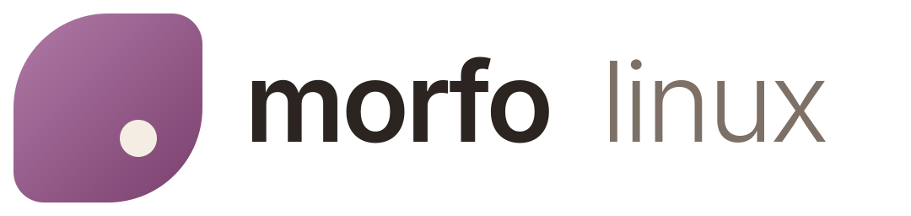
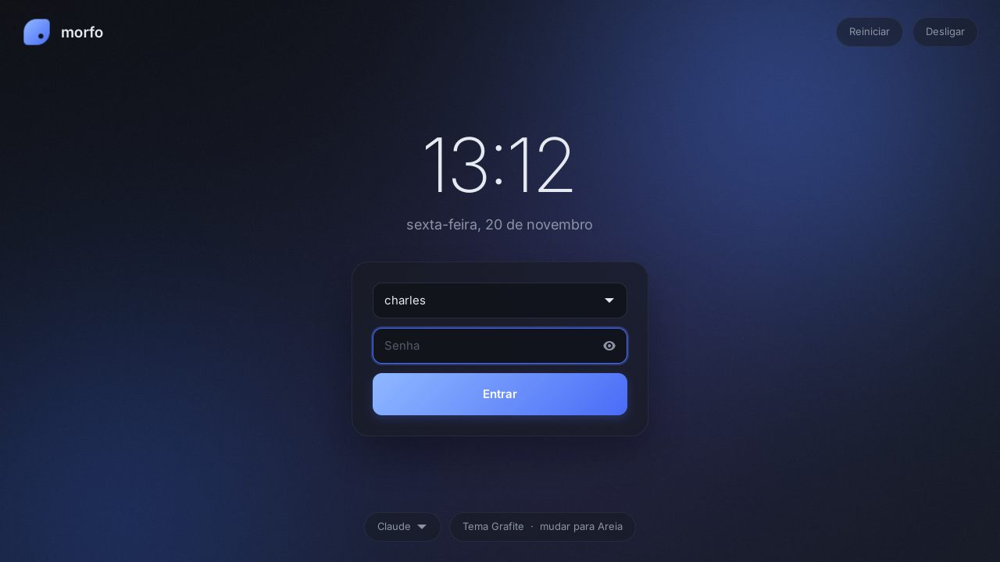
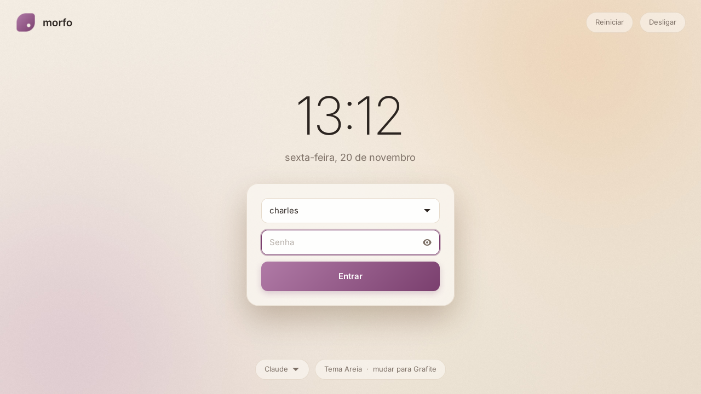

  <picture>
    <source media="(prefers-color-scheme: dark)" srcset="linux/docs/img/marca-escura.png">
    
  </picture>

<b>Computadores que começam numa conversa.</b>

O projeto Morfo tem duas frentes, com a mesma ideia: a interface é um chat, e a IA trabalha por
você dentro de limites que o sistema garante.

| | O que é | Estado |
|---|---|---|
| **[Morfo Linux](linux/)** | Debian mínimo que liga direto no Claude Desktop, em tela cheia, com dois temas | **Usável hoje** · ISO nas [Releases](../../releases) |
| **[Kernel Morfo](kernel/)** | Sistema operacional escrito do zero em Rust, com shell de chat e agente | Experimental · fases 1 e 2 |

  
  

O Morfo é um projeto independente, sem vínculo com a Anthropic. "Claude" é marca da Anthropic, PBC.
Licença [MIT](LICENSE).
