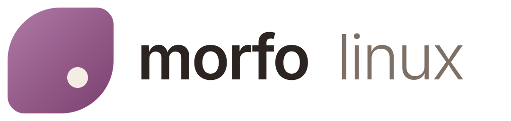
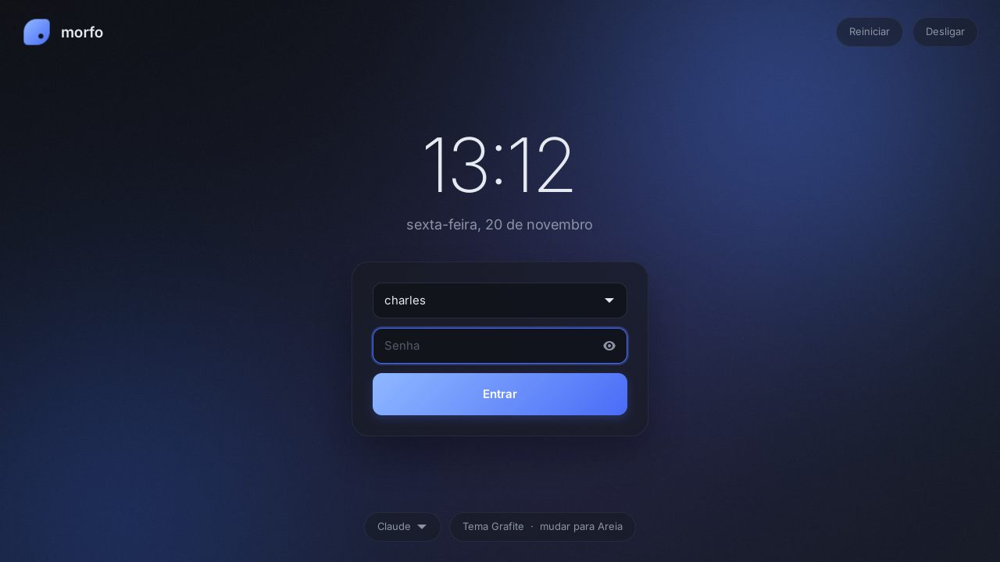
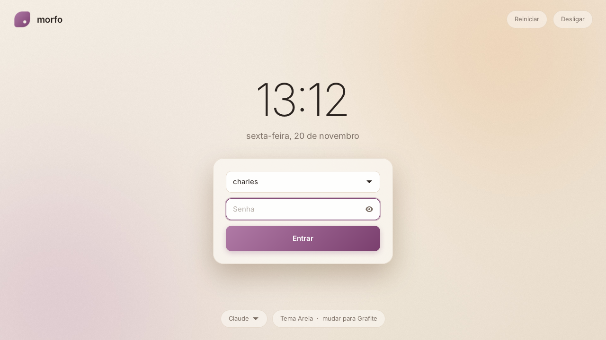
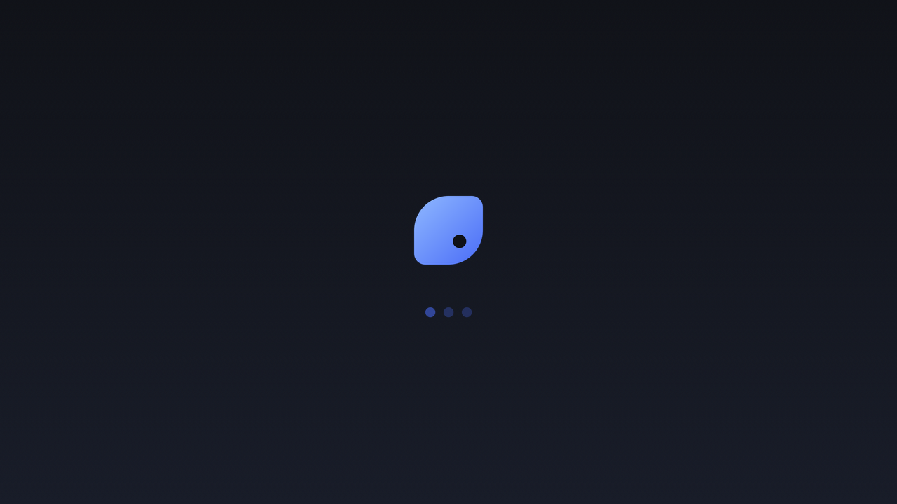
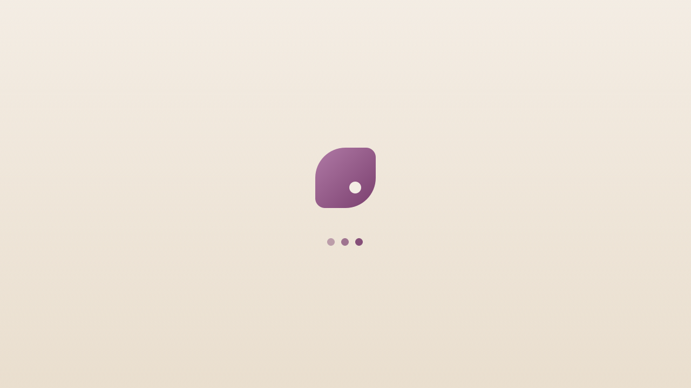
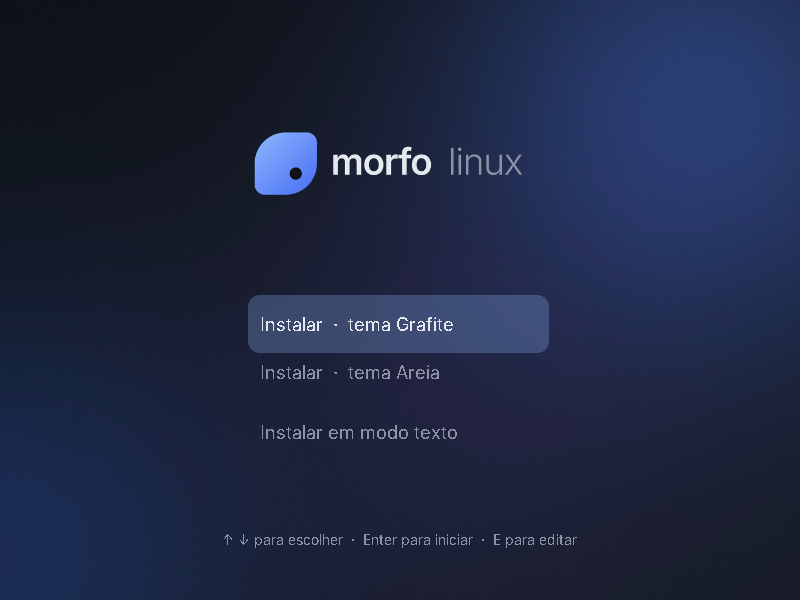

<p align="center">
  <picture>
    <source media="(prefers-color-scheme: dark)" srcset="docs/img/marca-escura.png">
    
  </picture>
</p>

<p align="center">
  <b>Um computador que liga direto numa conversa com o Claude.</b><br>
  Debian mínimo, sem área de trabalho, sem distrações. Feito para dar vida nova a máquinas antigas.
</p>

<p align="center">
  
  
</p>

---

## O que é

O Morfo Linux é uma distribuição em **modo quiosque**: você liga o computador, vê a animação de
boot, entra com sua senha e o **Claude Desktop** abre em tela cheia. Não há área de trabalho,
menus ou janelas para gerenciar. Ao fechar o Claude, você volta para a tela de login.

- **Base Debian 13** (ou 12), estável e com atualizações de segurança
- **Claude Desktop oficial**, instalado do repositório da Anthropic e atualizado pelo `apt`
- **Chat, Cowork e Code**, com a máquina virtual do Cowork já configurada (KVM)
- **Dois temas completos**, *Grafite* (escuro) e *Areia* (claro), do menu de boot ao terminal
- **Tela de login própria**, com troca de tema, Wi-Fi e terminal
- **Pensado para Macs antigos**: boot no firmware da Apple e driver do Wi-Fi Broadcom

## Telas

| | Grafite | Areia |
|---|---|---|
| **Boot** |  |  |
| **Login** |  |  |

<p align="center"><br><sub>Menu de boot do instalador</sub></p>

> As telas acima são capturas reais da tela de login, do Plymouth e do GRUB, geradas pelos
> próprios arquivos deste repositório.

## Instalar

> [!WARNING]
> A instalação **apaga o disco escolhido**. O instalador pergunta qual disco usar e pede confirmação.

1. Baixe a ISO na página de [Releases](../../releases) e confira o arquivo `.sha256`.
2. Grave num pendrive com o [balenaEtcher](https://etcher.balena.io) ou `dd`.
3. Ligue pelo pendrive. **No Mac**, segure **Option (⌥)** e escolha *EFI Boot*.
4. Escolha o tema no menu, siga o instalador **com cabo de rede** e reinicie.

O instalador pergunta só o essencial: teclado, fuso horário, seu usuário e senha, e o disco.
O resto é automático, inclusive o download do Claude Desktop.

### Já tem um Debian instalado?

```bash
git clone https://github.com/charlesmmorais/morfo.git
cd morfo/linux
sudo ./setup.sh areia      # ou grafite
sudo reboot
```

## Usando

| Quero… | Como |
|---|---|
| Trocar o tema | Botão **Tema** na tela de login (vale também para o boot) |
| Conectar no Wi-Fi | Na tela de login, escolha **Configurar Wi-Fi** e entre |
| Abrir um terminal | Escolha **Terminal**, ou `Ctrl+Alt+F2` |
| Atualizar tudo | `sudo apt update && sudo apt upgrade` |
| Trocar o tema pelo terminal | `sudo morfo-tema grafite` ou `sudo morfo-tema areia` |

## Requisitos

- PC ou Mac **x86-64**, com **4 GB** de RAM (8 GB recomendados para o Cowork)
- **SSD** recomendado
- Internet durante a instalação (cabo de rede: o Wi-Fi dos Macs só funciona depois)
- Virtualização (VT-x/AMD-V) ligada, para o Cowork
- Uma conta Claude (Free, Pro, Max, Team ou Enterprise)

Testado como alvo principal: **Mac mini (Mid 2011, A1347)**.

## Como é feito

```
linux/
├── branding/gerar.py        toda a identidade visual, gerada por código
├── installer/
│   ├── preseed.cfg          respostas automáticas do instalador Debian
│   ├── late.sh              passo final: roda o setup no sistema novo
│   └── grub.cfg             menu de boot da ISO
├── build/build-iso.sh       remasteriza o netinst oficial do Debian
├── setup.sh                 transforma um Debian no Morfo Linux
└── rootfs/                  arquivos do sistema
    ├── etc/greetd/          login gráfico (greetd)
    ├── usr/local/bin/       sessões: Claude, Wi-Fi, Terminal
    ├── usr/local/sbin/      morfo-tema
    └── usr/share/morfo/
        ├── greeter/         tela de login em GTK4 (Python) + CSS dos temas
        └── boot/            animação do Plymouth e tema do GRUB
```

A sessão é só o [cage](https://github.com/cage-kiosk/cage), um compositor Wayland de quiosque,
rodando o Claude Desktop. A tela de login é um programa GTK4 próprio que fala o protocolo do
[greetd](https://sr.ht/~kennylevinsen/greetd/).

Para gerar a ISO localmente (Ubuntu ou Debian):

```bash
sudo apt install xorriso cpio curl python3-numpy python3-pil librsvg2-bin grub-common fonts-inter
bash linux/build/build-iso.sh
```

No GitHub, cada tag `v*` gera e publica a ISO automaticamente.

## Aviso importante

O Morfo Linux é um projeto **independente e não oficial**, sem vínculo com a Anthropic.
"Claude" e "Anthropic" são marcas da Anthropic, PBC.

**A ISO não contém nenhum software da Anthropic.** O Claude Desktop é baixado do
[repositório oficial](https://code.claude.com/docs/en/desktop-linux) durante a instalação, na sua
máquina, e continua sujeito aos termos de uso da Anthropic. O suporte do Claude Desktop para Linux
está em beta.

## Licença

Código e identidade visual do Morfo Linux: [MIT](../LICENSE).
